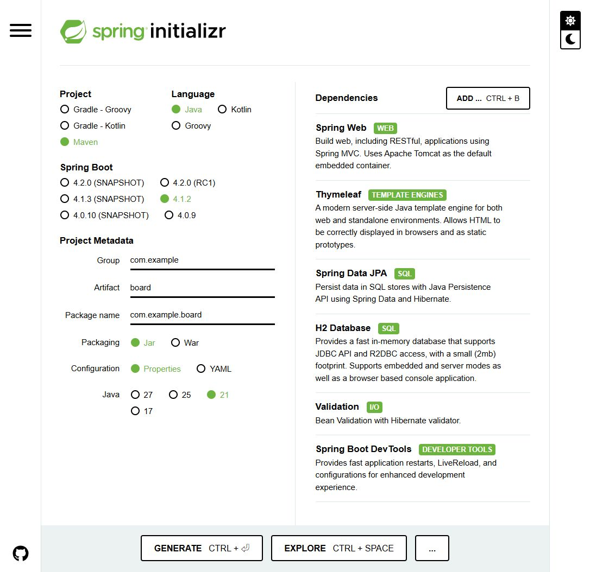

## 01. 먼저, 어떤 게시판을 만들까요? {#before}

이 가이드는 **Java + Spring MVC + Thymeleaf로 화면을 만들고, JPA + H2로 데이터를 저장하는 게시판**의 시작 설정을 다룹니다. 처음에는 별도 데이터베이스 설치 없이 실행해 보고, 이후 글 목록·상세·등록·수정·삭제 기능을 붙이는 순서입니다.

**이번 글의 도착점:** 프로젝트를 내려받아 실행하고, 브라우저에서 “게시판 프로젝트 준비 완료” 화면을 확인합니다. CRUD 기능과 회원 인증은 다음 구현 단계입니다.

- 준비물: **JDK 21**, **Visual Studio Code(VS Code)**, 인터넷 연결.
- 터미널에서 `java -version`과 `javac -version`을 실행해 JDK를 확인합니다. 이 가이드는 둘 다 21로 맞추는 구성을 권장합니다.
- Maven은 ZIP에 포함된 **Maven Wrapper**로 실행하므로 별도로 설치하지 않아도 됩니다. 첫 실행에는 다운로드 시간이 필요합니다.
- `spring2`는 이 블로그의 **폴더 이름**입니다. Spring Boot 2를 뜻하지 않습니다.

<aside class="note">GitHub Pages에는 이 설정 가이드가 게시됩니다. 실제 Spring Boot 게시판 서버는 내 PC의 <code>localhost:8080</code>에서 실행합니다.</aside>

## 02. 프로젝트 기본값 입력하기 {#settings}

[Spring Initializr 열기](https://start.spring.io/) → 왼쪽 항목을 아래 표와 같이 선택합니다. 화면의 초록색 표시가 선택된 값입니다.

| 항목 | 선택 / 입력값 | 선택 이유 |
| --- | --- | --- |
| Project | **Maven** | `pom.xml`에서 의존성을 확인하고 Wrapper로 실행합니다. |
| Language | **Java** | 이번 게시판 예제의 개발 언어입니다. |
| Spring Boot | **4.1.2** | 캡처 시점에 제공되는 정식 버전입니다. |
| Group | `com.example` | 연습용 패키지의 상위 이름입니다. |
| Artifact | `board` | 프로젝트와 내려받는 ZIP의 이름입니다. |
| Package name | `com.example.board` | 자바 소스의 기본 패키지입니다. Artifact 입력 후 확인합니다. |
| Packaging | **Jar** | 내장 서버를 포함해 단독으로 실행합니다. |
| Configuration | **Properties** | 이 글의 `application.properties` 예제와 맞춥니다. |
| Java | **21** | 프로젝트에서 사용할 Java 버전입니다. VS Code의 프로젝트 JDK도 맞춥니다. |

<figure><a href="images/01-project-settings.png" target="_blank" rel="noopener"></a><figcaption>캡처 1 · 기본 설정. 이미지를 누르면 원본 크기로 볼 수 있습니다.</figcaption></figure>

`SNAPSHOT`은 개발 중인 빌드이고 `RC`는 정식 출시 전 후보 버전입니다. 처음 따라 할 때는 숫자만 표시된 **정식 버전**을 선택합니다. 버전 목록은 바뀔 수 있으므로 나중에 4.1.2가 보이지 않으면 제공되는 정식 버전과 Java 호환성을 다시 확인하세요. [공식 시스템 요구사항](https://docs.spring.io/spring-boot/system-requirements.html)

## 03. 게시판에 필요한 의존성 6개 추가하기 {#dependencies}

오른쪽 **ADD …** 버튼을 누르고 이름을 검색한 다음 결과를 클릭합니다. 이 과정을 아래 6개 항목에 반복합니다. Windows에서는 `Ctrl + B`로 검색창을 열 수 있습니다.

<figure><a href="images/02-add-dependencies.png" target="_blank" rel="noopener"></a><figcaption>캡처 2 · Spring Web 검색. Spring MVC와 Tomcat이 설명에 나오는 항목을 선택합니다.</figcaption></figure>

| 검색어 / 선택할 이름 | 게시판에서 맡는 역할 | 이번 구성 |
| --- | --- | --- |
| **Spring Web** | 요청을 컨트롤러로 받고 내장 Tomcat 서버를 실행합니다. | 필수 |
| **Thymeleaf** | 글 목록·상세·입력 폼을 HTML 화면으로 보여줍니다. | 필수 |
| **Spring Data JPA** | 게시글 객체를 데이터베이스에 저장하고 조회합니다. | 필수 |
| **H2 Database** | 별도 설치 없이 로컬 실습용 DB를 사용합니다. | 필수 |
| **Validation** | 제목 필수 입력, 글 길이 같은 입력값을 검증할 때 사용합니다. | 추가 |
| **Spring Boot DevTools** | 개발 중 변경 사항을 반영할 때 재시작을 도와줍니다. | 개발 편의 |

Spring Web은 **Spring Reactive Web**과 다른 항목입니다. 이번 가이드는 MVC를 사용합니다. Lombok은 이 예제에 필요하지 않습니다. 로그인·권한 기능을 구현할 때는 Spring Security를 별도 단계에서 설정합니다.

<figure><a href="images/03-ready-to-generate.png" target="_blank" rel="noopener"></a><figcaption>캡처 3 · 생성 직전 체크. 왼쪽 설정과 오른쪽 의존성 6개를 모두 비교하세요.</figcaption></figure>

## 04. 생성 파일 확인하고 ZIP 다운로드하기 {#generate}

1. **EXPLORE**를 누르면 생성될 프로젝트 파일을 미리 볼 수 있습니다.
2. `pom.xml`에서 Spring Boot 버전 `4.1.2`와 `<java.version>21</java.version>`을 확인합니다.
3. **CLOSE**로 돌아온 뒤 **GENERATE**를 누릅니다. 미리보기 하단의 **DOWNLOAD**로도 ZIP을 받을 수 있습니다.
4. 내려받은 `board.zip`을 압축 해제합니다. **`pom.xml`이 들어 있는 폴더가 프로젝트 루트**입니다.

<figure><a href="images/04-explore-project.png" target="_blank" rel="noopener"></a><figcaption>캡처 4 · EXPLORE에서 pom.xml과 Maven Wrapper 파일을 확인한 화면.</figcaption></figure>

Spring Boot 4.1.2에서 이번 설정으로 생성되는 주요 의존성은 다음과 같습니다. **Initializr가 만든 `pom.xml`을 그대로 사용**하면 됩니다.

```text
spring-boot-starter-webmvc
spring-boot-starter-thymeleaf
spring-boot-starter-data-jpa
spring-boot-starter-validation
spring-boot-devtools
com.h2database:h2
spring-boot-h2console
```

`spring-boot-h2console`은 이 버전에서 H2 Database를 선택할 때 함께 생성됩니다. 테스트용 의존성도 추가되므로 `pom.xml`의 dependency 개수가 화면에서 고른 6개보다 많아도 정상입니다. `0.0.1-SNAPSHOT`은 **내 게시판 프로젝트 버전**으로, 위에서 피한 Spring Boot의 SNAPSHOT 버전과 구분합니다.

## 05. VS Code에서 프로젝트 열기 {#ide}

### ① Java·Spring 확장 설치

VS Code를 실행하고 왼쪽 **Extensions(확장)** 아이콘 또는 Windows의 `Ctrl + Shift + X`를 눌러 다음 두 확장 묶음을 검색해 설치합니다.

| 확장 이름 | 용도 |
| --- | --- |
| **Extension Pack for Java** | Java 코드 자동 완성, Maven 프로젝트 인식, 실행·디버깅·테스트 도구를 제공합니다. |
| **Spring Boot Extension Pack** | Spring 설정 지원과 Spring Boot Dashboard를 제공합니다. |

[VS Code 공식 Spring Boot 가이드](https://code.visualstudio.com/docs/java/java-spring-boot)에서 두 확장 묶음을 확인할 수 있습니다. 이 글에서는 앞서 Spring Initializr 웹사이트에서 받은 ZIP을 사용합니다.

### ② 압축 해제한 board 폴더 열기

1. **File → Open Folder…(파일 → 폴더 열기)**에서 `pom.xml`이 들어 있는 폴더를 선택합니다.
2. 왼쪽 Explorer(탐색기)에 `pom.xml`, `mvnw.cmd`, `src`가 함께 보이는지 확인합니다. `src`만 열면 프로젝트 루트로 다시 엽니다.
3. Java 확장이 Maven 프로젝트를 가져오고 의존성을 내려받을 때까지 기다립니다. Java Projects 뷰에서 프로젝트를 확인할 수 있습니다.
4. `src/main/java/com/example/board/BoardApplication.java`를 열어 `main` 메서드를 확인합니다.

### ③ 프로젝트 JDK와 터미널 Java 확인

1. `Ctrl + Shift + P`로 명령 팔레트를 열고 **Java: Configure Java Runtime**을 실행합니다.
2. 프로젝트의 Java 런타임 정보를 확인하고 **JDK 21** 설치 경로를 등록합니다. JDK가 없다면 **Java: Install New JDK**에서 21을 선택해 설치할 수 있습니다.
3. Maven 프로젝트의 Java 버전은 `pom.xml`의 `<java.version>21</java.version>`로 유지합니다. 런타임 설정의 기본값만 바꿔서는 Maven의 빌드 버전이 바뀌지 않습니다.
4. **Terminal → New Terminal(터미널 → 새 터미널)**에서 PowerShell을 열고 아래 명령을 실행합니다.

```powershell
java -version
javac -version
.\mvnw.cmd -v
```

세 출력에서 **Java 21** 사용 여부를 확인합니다. `mvnw.cmd -v`는 실제 Maven이 사용하는 Java 경로도 보여 줍니다. 다른 버전이 나온다면 Windows의 `JAVA_HOME`을 설치한 JDK 21 폴더로, `Path`의 Java 경로를 해당 JDK의 `bin`으로 맞춘 뒤 **VS Code를 완전히 종료하고 다시 열어** 확인합니다. 확장의 Java 런타임 선택과 터미널의 `JAVA_HOME`은 따로 확인해야 합니다.

VS Code의 Java 상태가 **Lightweight**이면 상태 표시줄에서 **Standard** 모드로 전환하고 프로젝트 로딩을 완료합니다. 실행·디버깅에는 의존성을 해석하는 Standard 모드가 필요합니다. [프로젝트 가져오기와 JDK 설정 공식 안내](https://code.visualstudio.com/docs/java/java-project)

### ④ 파일 위치 확인

VS Code 탐색기에서 아래 구조를 확인합니다. 다음 단계부터 이 탐색기에서 설정과 예제 파일을 추가하면 됩니다.

```text
board/                         ← pom.xml이 있는 폴더
├─ pom.xml                     ← 의존성 / Java / Boot 버전
├─ mvnw, mvnw.cmd, .mvn/        ← Maven Wrapper
└─ src/
   ├─ main/
   │  ├─ java/com/example/board/
   │  │  └─ BoardApplication.java
   │  └─ resources/
   │     ├─ application.properties
   │     ├─ templates/         ← Thymeleaf HTML
   │     └─ static/            ← CSS, JavaScript, 이미지
   └─ test/                    ← 생성된 테스트
```

## 06. 로컬 실습용 DB 설정하기 {#database}

VS Code 탐색기에서 `src/main/resources/application.properties`를 열고 아래 내용을 저장합니다. 이 단계는 **Initializr에서 받은 뒤 VS Code에서 직접 추가하는 설정**입니다.

```properties
spring.application.name=board
server.address=127.0.0.1
server.port=8080

spring.datasource.url=jdbc:h2:mem:boarddb
spring.datasource.driver-class-name=org.h2.Driver
spring.datasource.username=sa
spring.datasource.password=

spring.jpa.hibernate.ddl-auto=update
spring.jpa.show-sql=true
spring.jpa.properties.hibernate.format_sql=true
spring.jpa.open-in-view=false

spring.h2.console.enabled=true
spring.h2.console.path=/h2-console
spring.h2.console.settings.web-allow-others=false
```

- `jdbc:h2:mem:boarddb`는 **메모리 DB**입니다. 애플리케이션을 완전히 종료하면 게시글 데이터도 사라집니다.
- `ddl-auto=update`는 앞으로 만들 Entity에 맞춰 테이블을 갱신하는 **로컬 학습용 설정**입니다. 운영 DB에는 별도 마이그레이션 방식을 적용합니다.
- JPA의 `open-in-view=false`를 사용하므로 이후 게시판에서는 서비스의 트랜잭션 안에서 필요한 데이터를 조회해 화면에 전달하도록 구현합니다.
- H2 콘솔은 로컬 실습용입니다. 서버 주소를 `127.0.0.1`로 제한했으며 운영 환경에는 이 설정을 그대로 사용하지 않습니다.

## 07. 첫 화면을 만들고 실행 확인하기 {#run}

프로젝트만 생성하면 `/` 주소를 처리하는 화면이 아직 없어 404가 나올 수 있습니다. 아래 **두 파일**을 추가해 웹 요청과 Thymeleaf 렌더링이 연결되는지 확인합니다.

### ① HomeController.java 추가

위치: `src/main/java/com/example/board/HomeController.java`

```java
package com.example.board;

import org.springframework.stereotype.Controller;
import org.springframework.ui.Model;
import org.springframework.web.bind.annotation.GetMapping;

@Controller
public class HomeController {
    @GetMapping("/")
    public String home(Model model) {
        model.addAttribute("message", "게시판 프로젝트 준비 완료");
        return "index";
    }
}
```

### ② index.html 추가

위치: `src/main/resources/templates/index.html`

```html
<!DOCTYPE html>
<html lang="ko" xmlns:th="http://www.thymeleaf.org">
<head>
    <meta charset="UTF-8">
    <meta name="viewport" content="width=device-width, initial-scale=1">
    <title>게시판 시작</title>
</head>
<body>
    <h1 th:text="${message}">준비 중</h1>
    <p>Spring MVC와 Thymeleaf가 정상 연결되었습니다.</p>
</body>
</html>
```

컨트롤러의 `return "index"`는 `templates/index.html`을 가리킵니다. 블로그의 `spring2/index.html`과는 **서로 다른 파일**입니다.

### ③ VS Code 통합 터미널에서 실행

파일을 저장한 뒤 **Terminal → New Terminal(터미널 → 새 터미널)**을 엽니다. 터미널의 현재 위치가 `pom.xml`이 있는 폴더인지 확인합니다. VS Code의 Run/Debug나 다른 터미널에서 이미 실행 중이면 먼저 종료하세요.

**Windows PowerShell**

```powershell
.\mvnw.cmd -v
.\mvnw.cmd test
.\mvnw.cmd spring-boot:run
```

**macOS / Linux**

```bash
chmod +x mvnw
./mvnw -v
./mvnw test
./mvnw spring-boot:run
```

`-v` 출력에서 사용하는 Java 버전과 경로를 확인합니다. 실행 로그에 `Started BoardApplication`과 Tomcat의 8080 포트 시작 메시지가 나오면 브라우저에서 [http://localhost:8080](http://localhost:8080/)을 엽니다.

**성공 기준:** “게시판 프로젝트 준비 완료”와 “Spring MVC와 Thymeleaf가 정상 연결되었습니다.”가 표시됩니다. 터미널에서 `Ctrl + C`를 누르면 서버가 종료됩니다.

**VS Code의 실행 버튼을 사용하려면:** 터미널에서 실행한 서버를 먼저 종료하고 `BoardApplication.java`의 `main` 메서드 위 **Run** 또는 **Debug**를 클릭합니다. **F5**로 디버깅을 시작하거나 **Spring Boot Dashboard**에서 `board` 프로젝트를 시작·중지할 수도 있습니다. 중단점은 코드 왼쪽 여백에 표시하고 Debug로 실행합니다. 디버깅 종료는 상단 Stop 버튼 또는 `Shift + F5`를 사용합니다. [VS Code Java 실행·디버깅 공식 안내](https://code.visualstudio.com/docs/java/java-debugging)

### ④ H2 콘솔 접속 확인

애플리케이션이 실행 중일 때 [http://localhost:8080/h2-console](http://localhost:8080/h2-console)에 접속합니다.

| 입력 항목 | 값 |
| --- | --- |
| Driver Class | `org.h2.Driver` |
| JDBC URL | `jdbc:h2:mem:boarddb` |
| User Name | `sa` |
| Password | 빈칸 |

**Connect**를 눌러 연결되면 DB 준비도 끝났습니다. 아직 Entity를 만들지 않았으므로 게시글 테이블이 없는 것이 정상입니다. 콘솔의 기본 JDBC URL을 그대로 두지 말고 위 값으로 바꿔 주세요.

## 08. 자주 막히는 지점과 다음 단계 {#next}

| 증상 | 확인할 내용 |
| --- | --- |
| `release version 21 not supported` | VS Code 터미널의 `.\mvnw.cmd -v`에서 Java 버전을 확인합니다. `JAVA_HOME`과 프로젝트의 JDK 21 설정을 맞춥니다. |
| `JAVA_HOME` 관련 오류 | JDK가 설치되어 있는지, `JAVA_HOME`이 `bin`이 아닌 JDK 폴더를 가리키는지 확인하고 터미널을 다시 엽니다. |
| 8080 포트가 이미 사용 중 | 기존 실행을 종료하거나 `server.port=8081`로 변경한 뒤 `localhost:8081`에 접속합니다. |
| 첫 실행에 오래 걸림 / 의존성 다운로드 실패 | 인터넷·프록시 설정과 Maven 다운로드 오류를 확인합니다. 프로젝트를 다시 만들기 전에 원인 메시지를 읽습니다. |
| VS Code에 Run/Debug가 보이지 않음 | Extension Pack for Java 설치, `pom.xml`이 있는 폴더 열기, 프로젝트 로딩 완료, Java Standard 모드 여부를 확인합니다. |
| Java 프로젝트가 인식되지 않음 | 명령 팔레트에서 `Java: Import Java projects in workspace`를 실행합니다. 의존성 인식 문제가 계속되면 `Java: Clean Java Language Server Workspace`로 Java 작업 영역을 다시 로드합니다. |
| 첫 화면에서 404 | `HomeController`가 `com.example.board` 아래 있는지, `@Controller`와 `@GetMapping("/")`가 있는지 확인합니다. |
| 템플릿을 찾을 수 없음 | 파일이 `static`이 아니라 `templates/index.html`에 있는지, Thymeleaf가 추가됐는지 확인합니다. |
| H2 콘솔 404 | 설정 저장 후 재시작하고 `spring-boot-h2console` 의존성 및 콘솔 경로를 확인합니다. |
| H2 DB가 없다는 메시지 | 서버 실행 상태와 JDBC URL `jdbc:h2:mem:boarddb`가 일치하는지 확인합니다. |

다음에는 `Board` Entity → `BoardRepository` → `BoardService` → `BoardController` → Thymeleaf 화면 순서로 구현합니다. 목록·상세·등록을 먼저 연결하고, 수정·삭제·입력값 검증을 추가하면 기본 게시판 흐름을 완성할 수 있습니다.

### 완료 체크리스트

- [ ] Maven / Java / 정식 Spring Boot / Jar / Properties / Java 21 선택
- [ ] Group `com.example`, Artifact `board`, Package `com.example.board` 확인
- [ ] 의존성 6개 추가 및 `board.zip` 다운로드
- [ ] VS Code에 Extension Pack for Java와 Spring Boot Extension Pack 설치
- [ ] VS Code에서 board 폴더 열기 및 프로젝트 JDK·터미널 Java 21 확인
- [ ] 로컬 H2 설정과 첫 화면 예제 추가
- [ ] 테스트 통과, 첫 화면 표시, H2 연결 확인

### 참고한 공식 자료

- [Spring Initializr](https://start.spring.io/) — 설정 화면과 생성 프로젝트
- [Spring Boot 시스템 요구사항](https://docs.spring.io/spring-boot/system-requirements.html) — Java·빌드 도구 호환성
- [Serving Web Content with Spring MVC](https://spring.io/guides/gs/serving-web-content/) — MVC와 Thymeleaf 연결
- [Accessing Data with JPA](https://spring.io/guides/gs/accessing-data-jpa/) — JPA와 H2
- [Validating Form Input](https://spring.io/guides/gs/validating-form-input/) — 입력 검증
- [Spring Boot in VS Code](https://code.visualstudio.com/docs/java/java-spring-boot) — Java·Spring 확장 설치와 Dashboard
- [Managing Java Projects in VS Code](https://code.visualstudio.com/docs/java/java-project) — 폴더 열기, Maven 인식, JDK 설정
- [Running and debugging Java](https://code.visualstudio.com/docs/java/java-debugging) — Run/Debug와 F5 실행

화면 캡처 및 설정 확인: **2026-10-27 (한국 시간)**. 캡처는 Spring Initializr의 실제 화면이며, 사이트 개편이나 버전 업데이트에 따라 표시가 달라질 수 있습니다.
