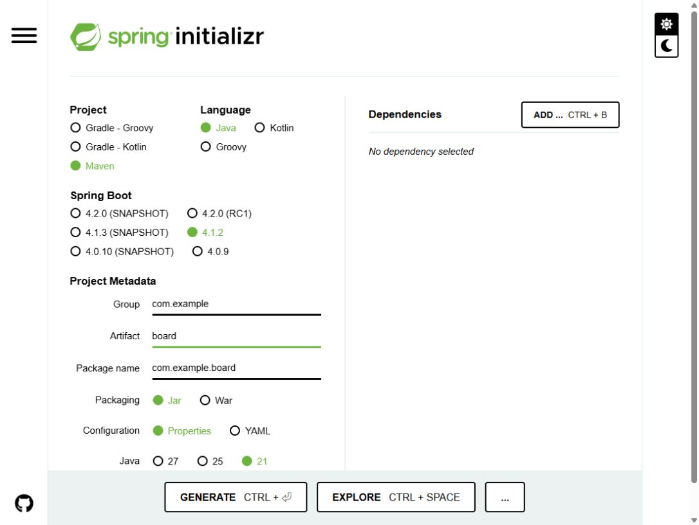
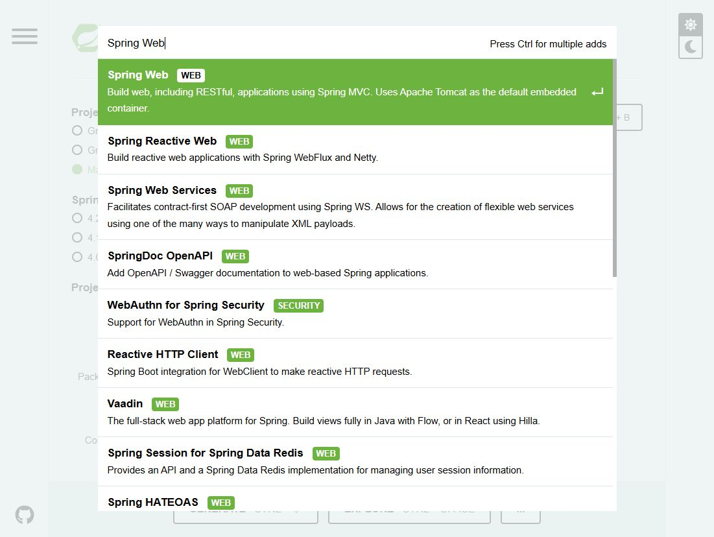
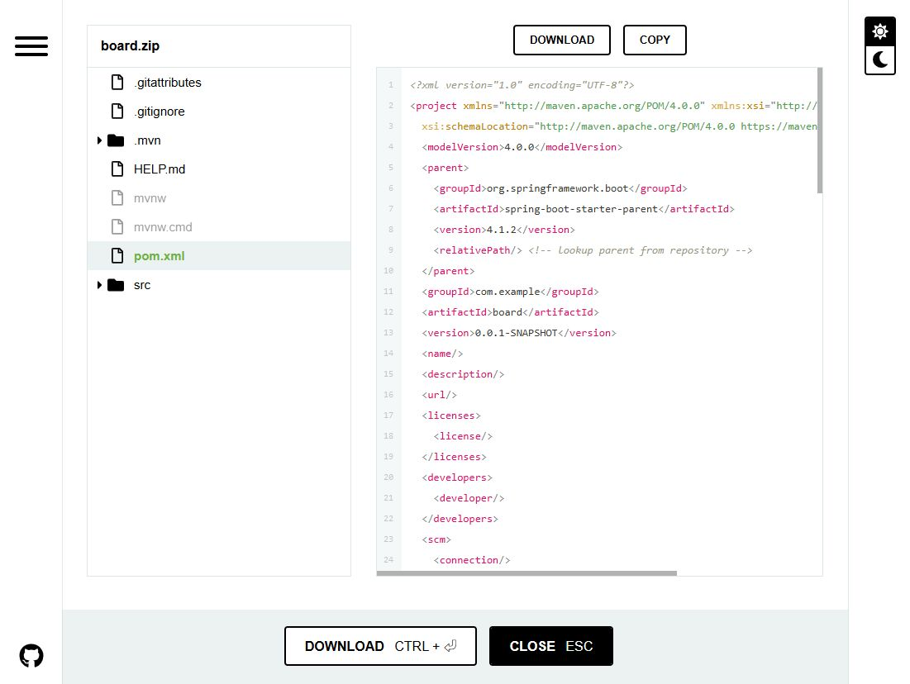
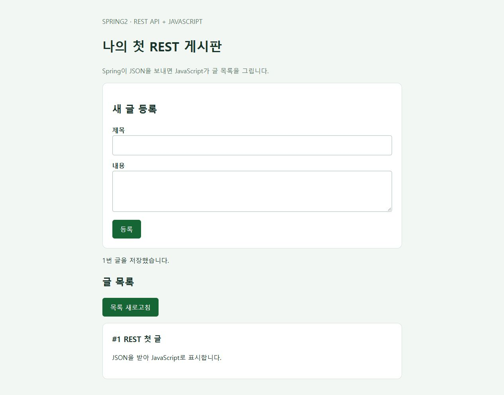

## 01. 이번에는 REST API + JavaScript 게시판입니다 {#before}

**Spring Boot는 게시글 데이터를 JSON으로 반환하고, 브라우저의 JavaScript가 그 데이터를 받아 화면을 만듭니다.** 프런트엔드는 순수 JavaScript로 먼저 실습합니다. React와 Vue도 같은 REST API를 호출할 수 있으므로, 이후 화면 기술만 바꿀 수 있습니다.

```text
브라우저의 HTML + JavaScript
      │ fetch()로 GET / POST 요청
      ▼
Spring REST API → JPA → H2 데이터베이스
      │ JSON 응답
      ▼
JavaScript가 글 목록과 등록 결과를 화면에 표시
```

**이번 글의 도착점:** 글 등록, 목록 조회, 상세 조회 API를 만들고 실제 DB에 저장된 글을 JavaScript 화면에서 확인합니다. 수정·삭제·회원 인증은 다음 단계입니다.

| 역할 | 이번 실습 | 나중에 바꿀 수 있는 부분 |
| --- | --- | --- |
| 백엔드 | Spring Boot + Spring Web + JPA + H2 | MySQL/PostgreSQL, 인증, 서비스 계층 추가 |
| API 형식 | `/api/posts`에서 JSON 요청·응답 | React/Vue에서도 같은 주소·형식을 사용 |
| 프런트엔드 | HTML + CSS + JavaScript의 `fetch()` | React 컴포넌트 또는 Vue 컴포넌트로 전환 |

- 준비물: **JDK 21**, **VS Code**, 인터넷 연결. 이 순수 JavaScript 예제에는 Node.js 설치가 필요하지 않습니다.
- Maven은 생성된 프로젝트의 **Maven Wrapper**로 실행합니다.
- 첫 실습에서는 Spring Boot가 `static/`의 HTML·JS 파일도 제공하므로 한 서버만 실행합니다. 게시글 화면은 브라우저에서 JSON을 읽어 구성합니다.
- `spring2`는 블로그 폴더 이름이며 Spring Boot 2를 뜻하지 않습니다.

<aside class="note">이 GitHub Pages 주소에는 가이드만 게시됩니다. 실제 게시판 API와 H2 DB는 내 PC의 Spring Boot에서 실행합니다. 웹에 서비스하려면 백엔드 실행 환경을 별도로 마련해야 합니다.</aside>

[완성된 실습 프로젝트 ZIP 다운로드](board-rest-example.zip) · 압축을 풀고 `board/pom.xml`이 있는 폴더를 VS Code에서 열면 됩니다. 아래 코드를 직접 입력해도 같은 결과를 얻습니다.

### 이전 가이드를 따라 만들었다면

`pom.xml`에서 `spring-boot-starter-thymeleaf`와 `spring-boot-starter-thymeleaf-test` 의존성을 제거합니다. 이전 실습의 `HomeController.java`와 `templates/index.html`도 제거한 뒤 아래 REST 컨트롤러와 `static/index.html`, `static/app.js`로 바꿉니다. 기존 `/` 컨트롤러가 남아 있으면 새 정적 첫 화면과 충돌할 수 있습니다.

## 02. 프로젝트 기본값 입력하기 {#settings}

[Spring Initializr 열기](https://start.spring.io/) → 왼쪽 항목을 아래 표와 같이 선택합니다. 화면의 초록색 표시가 선택된 값입니다.

| 항목 | 선택 / 입력값 | 선택 이유 |
| --- | --- | --- |
| Project | **Maven** | `pom.xml`에서 의존성을 확인하고 Wrapper로 실행합니다. |
| Language | **Java** | 이번 게시판 예제의 개발 언어입니다. |
| Spring Boot | **4.1.2** | 캡처 시점에 제공되는 정식 버전입니다. |
| Group | `com.example` | 연습용 패키지의 상위 이름입니다. |
| Artifact | `board` | 프로젝트와 내려받는 ZIP의 이름입니다. |
| Package name | `com.example.board` | 자바 소스의 기본 패키지입니다. Artifact 입력 후 확인합니다. |
| Packaging | **Jar** | 내장 서버를 포함해 단독으로 실행합니다. |
| Configuration | **Properties** | 이 글의 `application.properties` 예제와 맞춥니다. |
| Java | **21** | 프로젝트에서 사용할 Java 버전입니다. VS Code의 프로젝트 JDK도 맞춥니다. |

<figure><a href="images/01-project-settings.png" target="_blank" rel="noopener"></a><figcaption>캡처 1 · 기본 설정. 이미지를 누르면 원본 크기로 볼 수 있습니다.</figcaption></figure>

`SNAPSHOT`은 개발 중인 빌드이고 `RC`는 정식 출시 전 후보 버전입니다. 처음 따라 할 때는 숫자만 표시된 **정식 버전**을 선택합니다. 버전 목록은 바뀔 수 있으므로 나중에 4.1.2가 보이지 않으면 제공되는 정식 버전과 Java 호환성을 다시 확인하세요. [공식 시스템 요구사항](https://docs.spring.io/spring-boot/system-requirements.html)

## 03. 게시판에 필요한 의존성 5개 추가하기 {#dependencies}

오른쪽 **ADD …** 버튼을 누르고 이름을 검색한 다음 결과를 클릭합니다. 이 과정을 아래 5개 항목에 반복합니다. Windows에서는 `Ctrl + B`로 검색창을 열 수 있습니다.

<figure><a href="images/02-add-dependencies.png" target="_blank" rel="noopener"></a><figcaption>캡처 2 · Spring Web 검색. Spring MVC와 Tomcat이 설명에 나오는 항목을 선택합니다.</figcaption></figure>

| 검색어 / 선택할 이름 | 게시판에서 맡는 역할 | 이번 구성 |
| --- | --- | --- |
| **Spring Web** | 요청을 컨트롤러로 받고 내장 Tomcat 서버를 실행합니다. | 필수 |
| **Spring Data JPA** | 게시글 객체를 데이터베이스에 저장하고 조회합니다. | 필수 |
| **H2 Database** | 별도 설치 없이 로컬 실습용 DB를 사용합니다. | 필수 |
| **Validation** | 제목 필수 입력, 글 길이 같은 입력값을 검증할 때 사용합니다. | 추가 |
| **Spring Boot DevTools** | 개발 중 변경 사항을 반영할 때 재시작을 도와줍니다. | 개발 편의 |

Spring Web은 **Spring Reactive Web**과 다른 항목입니다. 이번 REST API도 Spring MVC 기반의 Spring Web을 사용합니다. **Thymeleaf는 추가하지 않습니다.** Lombok은 이 예제에 필요하지 않습니다. 로그인·권한 기능을 구현할 때는 Spring Security를 별도 단계에서 설정합니다.

<aside class="note">생성 직전 Dependencies 목록에 Spring Web, Spring Data JPA, H2 Database, Validation, Spring Boot DevTools의 5개 항목이 있는지 확인합니다. Thymeleaf는 제외합니다.</aside>

## 04. 생성 파일 확인하고 ZIP 다운로드하기 {#generate}

1. **EXPLORE**를 누르면 생성될 프로젝트 파일을 미리 볼 수 있습니다.
2. `pom.xml`에서 Spring Boot 버전 `4.1.2`와 `<java.version>21</java.version>`을 확인합니다.
3. **CLOSE**로 돌아온 뒤 **GENERATE**를 누릅니다. 미리보기 하단의 **DOWNLOAD**로도 ZIP을 받을 수 있습니다.
4. 내려받은 `board.zip`을 압축 해제합니다. **`pom.xml`이 들어 있는 폴더가 프로젝트 루트**입니다.

<figure><a href="images/04-explore-project.png" target="_blank" rel="noopener"></a><figcaption>캡처 3 · EXPLORE에서 pom.xml과 Maven Wrapper 파일을 확인한 화면.</figcaption></figure>

Spring Boot 4.1.2에서 이번 설정으로 생성되는 주요 의존성은 다음과 같습니다. **Initializr가 만든 `pom.xml`을 그대로 사용**하면 됩니다.

```text
spring-boot-starter-webmvc
spring-boot-starter-data-jpa
spring-boot-starter-validation
spring-boot-devtools
com.h2database:h2
spring-boot-h2console
```

`spring-boot-h2console`은 이 버전에서 H2 Database를 선택할 때 함께 생성됩니다. 테스트용 의존성도 추가되므로 `pom.xml`의 dependency 개수가 화면에서 고른 5개보다 많아도 정상입니다. `0.0.1-SNAPSHOT`은 **내 게시판 프로젝트 버전**으로, 위에서 피한 Spring Boot의 SNAPSHOT 버전과 구분합니다.

## 05. VS Code에서 프로젝트 열기 {#ide}

### ① Java·Spring 확장 설치

VS Code를 실행하고 왼쪽 **Extensions(확장)** 아이콘 또는 Windows의 `Ctrl + Shift + X`를 눌러 다음 두 확장 묶음을 검색해 설치합니다.

| 확장 이름 | 용도 |
| --- | --- |
| **Extension Pack for Java** | Java 코드 자동 완성, Maven 프로젝트 인식, 실행·디버깅·테스트 도구를 제공합니다. |
| **Spring Boot Extension Pack** | Spring 설정 지원과 Spring Boot Dashboard를 제공합니다. |

[VS Code 공식 Spring Boot 가이드](https://code.visualstudio.com/docs/java/java-spring-boot)에서 두 확장 묶음을 확인할 수 있습니다. 이 글에서는 앞서 Spring Initializr 웹사이트에서 받은 ZIP을 사용합니다.

### ② 압축 해제한 board 폴더 열기

1. **File → Open Folder…(파일 → 폴더 열기)**에서 `pom.xml`이 들어 있는 폴더를 선택합니다.
2. 왼쪽 Explorer(탐색기)에 `pom.xml`, `mvnw.cmd`, `src`가 함께 보이는지 확인합니다. `src`만 열면 프로젝트 루트로 다시 엽니다.
3. Java 확장이 Maven 프로젝트를 가져오고 의존성을 내려받을 때까지 기다립니다. Java Projects 뷰에서 프로젝트를 확인할 수 있습니다.
4. `src/main/java/com/example/board/BoardApplication.java`를 열어 `main` 메서드를 확인합니다.

### ③ 프로젝트 JDK와 터미널 Java 확인

1. `Ctrl + Shift + P`로 명령 팔레트를 열고 **Java: Configure Java Runtime**을 실행합니다.
2. 프로젝트의 Java 런타임 정보를 확인하고 **JDK 21** 설치 경로를 등록합니다. JDK가 없다면 **Java: Install New JDK**에서 21을 선택해 설치할 수 있습니다.
3. Maven 프로젝트의 Java 버전은 `pom.xml`의 `<java.version>21</java.version>`로 유지합니다. 런타임 설정의 기본값만 바꿔서는 Maven의 빌드 버전이 바뀌지 않습니다.
4. **Terminal → New Terminal(터미널 → 새 터미널)**에서 PowerShell을 열고 아래 명령을 실행합니다.

```powershell
java -version
javac -version
.\mvnw.cmd -v
```

세 출력에서 **Java 21** 사용 여부를 확인합니다. `mvnw.cmd -v`는 실제 Maven이 사용하는 Java 경로도 보여 줍니다. 다른 버전이 나온다면 Windows의 `JAVA_HOME`을 설치한 JDK 21 폴더로, `Path`의 Java 경로를 해당 JDK의 `bin`으로 맞춘 뒤 **VS Code를 완전히 종료하고 다시 열어** 확인합니다. 확장의 Java 런타임 선택과 터미널의 `JAVA_HOME`은 따로 확인해야 합니다.

VS Code의 Java 상태가 **Lightweight**이면 상태 표시줄에서 **Standard** 모드로 전환하고 프로젝트 로딩을 완료합니다. 실행·디버깅에는 의존성을 해석하는 Standard 모드가 필요합니다. [프로젝트 가져오기와 JDK 설정 공식 안내](https://code.visualstudio.com/docs/java/java-project)

### ④ 파일 위치 확인

VS Code 탐색기에서 아래 완성 구조를 기준으로 파일을 추가합니다. 다음 단계부터 이 탐색기에서 설정과 예제 파일을 추가하면 됩니다.

```text
board/                         ← pom.xml이 있는 폴더
├─ pom.xml                     ← 의존성 / Java / Boot 버전
├─ mvnw, mvnw.cmd, .mvn/        ← Maven Wrapper
└─ src/
   ├─ main/
   │  ├─ java/com/example/board/
   │  │  ├─ BoardApplication.java
   │  │  ├─ Post.java
   │  │  ├─ PostRepository.java
   │  │  └─ PostController.java
   │  └─ resources/
   │     ├─ application.properties
   │     └─ static/
   │        ├─ index.html     ← 화면 구조
   │        └─ app.js         ← JSON 요청과 화면 구성
   └─ test/                    ← 생성된 테스트
```

## 06. 로컬 H2 DB 설정하기 {#database}

VS Code에서 `src/main/resources/application.properties`에 다음을 저장합니다.

```properties
spring.application.name=board
server.address=127.0.0.1
server.port=8080

spring.datasource.url=jdbc:h2:mem:boarddb
spring.datasource.driver-class-name=org.h2.Driver
spring.datasource.username=sa
spring.datasource.password=

spring.jpa.hibernate.ddl-auto=update
spring.jpa.show-sql=true
spring.jpa.properties.hibernate.format_sql=true
spring.jpa.open-in-view=false

spring.h2.console.enabled=true
spring.h2.console.path=/h2-console
spring.h2.console.settings.web-allow-others=false
```

- `jdbc:h2:mem:boarddb`는 메모리 DB입니다. **브라우저 새로고침은 데이터를 유지하지만 서버 프로세스를 종료하면 데이터가 사라집니다.**
- `ddl-auto=update`는 로컬 실습용입니다. 실제 운영 DB는 별도 마이그레이션 방식으로 관리합니다.
- `server.address=127.0.0.1`은 내 PC에서만 접근하도록 제한합니다. H2 콘솔도 로컬 실습용으로 사용합니다.

## 07. JSON을 반환하는 게시판 API 만들기 {#api}

VS Code 탐색기에서 다음 세 파일을 `src/main/java/com/example/board/` 아래에 추가합니다. 생성된 `BoardApplication.java`는 유지합니다.

| 요청 | 동작 | 정상 응답 |
| --- | --- | --- |
| `GET /api/posts` | 최신 ID 순으로 목록 조회 | `200 OK`, JSON 배열 |
| `GET /api/posts/{id}` | 글 하나 조회 | `200 OK`, JSON 객체. 없는 ID는 `404` |
| `POST /api/posts` | JSON으로 받은 글 저장 | `201 Created`, 저장한 JSON 객체와 Location 헤더 |

### ① Post.java — DB에 저장할 Entity

```java
package com.example.board;

import jakarta.persistence.Column;
import jakarta.persistence.Entity;
import jakarta.persistence.GeneratedValue;
import jakarta.persistence.GenerationType;
import jakarta.persistence.Id;
import jakarta.persistence.Table;

@Entity
@Table(name = "posts")
public class Post {
    @Id
    @GeneratedValue(strategy = GenerationType.IDENTITY)
    private Long id;

    @Column(nullable = false, length = 100)
    private String title;

    @Column(nullable = false, length = 5000)
    private String content;

    protected Post() {}

    public Post(String title, String content) {
        this.title = title;
        this.content = content;
    }

    public Long getId() { return id; }
    public String getTitle() { return title; }
    public String getContent() { return content; }
}
```

### ② PostRepository.java — 저장·조회

```java
package com.example.board;

import org.springframework.data.jpa.repository.JpaRepository;

public interface PostRepository extends JpaRepository<Post, Long> {}
```

### ③ PostController.java — 요청과 JSON 응답

```java
package com.example.board;

import java.net.URI;
import java.util.List;
import java.util.Map;
import jakarta.validation.Valid;
import jakarta.validation.constraints.NotBlank;
import jakarta.validation.constraints.Size;
import org.springframework.data.domain.Sort;
import org.springframework.http.HttpStatus;
import org.springframework.http.ResponseEntity;
import org.springframework.web.bind.MethodArgumentNotValidException;
import org.springframework.web.bind.annotation.ExceptionHandler;
import org.springframework.web.bind.annotation.GetMapping;
import org.springframework.web.bind.annotation.PathVariable;
import org.springframework.web.bind.annotation.PostMapping;
import org.springframework.web.bind.annotation.RequestBody;
import org.springframework.web.bind.annotation.RequestMapping;
import org.springframework.web.bind.annotation.RestController;
import org.springframework.web.server.ResponseStatusException;

@RestController
@RequestMapping("/api/posts")
public class PostController {
    private final PostRepository repository;

    public PostController(PostRepository repository) {
        this.repository = repository;
    }

    public record CreatePostRequest(
        @NotBlank @Size(max = 100) String title,
        @NotBlank @Size(max = 5000) String content
    ) {}

    public record PostResponse(Long id, String title, String content) {
        static PostResponse from(Post post) {
            return new PostResponse(post.getId(), post.getTitle(), post.getContent());
        }
    }

    @GetMapping
    public List<PostResponse> list() {
        return repository.findAll(Sort.by(Sort.Direction.DESC, "id"))
                .stream().map(PostResponse::from).toList();
    }

    @GetMapping("/{id}")
    public PostResponse detail(@PathVariable Long id) {
        Post post = repository.findById(id)
                .orElseThrow(() -> new ResponseStatusException(HttpStatus.NOT_FOUND));
        return PostResponse.from(post);
    }

    @PostMapping
    public ResponseEntity<PostResponse> create(@Valid @RequestBody CreatePostRequest request) {
        Post saved = repository.save(new Post(request.title().trim(), request.content().trim()));
        return ResponseEntity.created(URI.create("/api/posts/" + saved.getId()))
                .body(PostResponse.from(saved));
    }

    @ExceptionHandler(MethodArgumentNotValidException.class)
    public ResponseEntity<Map<String, String>> invalidInput() {
        return ResponseEntity.badRequest().body(Map.of(
                "message", "제목은 1~100자, 내용은 1~5000자로 입력하세요. 공백만 입력할 수 없습니다."));
    }
}
```

`@RestController`는 반환한 DTO를 응답 본문으로 보내고, Spring Web의 JSON 변환기가 객체·목록을 JSON으로 직렬화합니다. `@RequestBody`는 요청 JSON을 Java 객체로 읽습니다. `@Valid`는 제목·내용을 검증하고, 잘못된 입력에는 `400 Bad Request`를 반환합니다. [응답 본문 공식 설명](https://docs.spring.io/spring-framework/reference/web/webmvc/mvc-controller/ann-methods/responsebody.html) · [요청 본문·검증 공식 설명](https://docs.spring.io/spring-framework/reference/web/webmvc/mvc-controller/ann-methods/requestbody.html)

`PostResponse`는 외부에 보낼 필드만 정한 DTO입니다. 이 입문 예제는 컨트롤러에서 Repository를 직접 호출합니다. 여러 저장 작업을 묶거나 업무 규칙이 생기면 Service와 트랜잭션으로 분리합니다.

## 08. JavaScript로 화면 구성하기 {#frontend}

다음 두 파일은 `src/main/resources/static/`에 만듭니다. **`templates/`에 넣지 않습니다.** Spring Boot가 파일을 전달하면, 브라우저에서 `app.js`가 실행되어 API를 호출합니다.

### ① static/index.html — 글 입력 폼과 목록 자리

```html
<!DOCTYPE html>
<html lang="ko">
<head>
  <meta charset="UTF-8">
  <meta name="viewport" content="width=device-width, initial-scale=1">
  <title>Spring REST 게시판</title>
  <style>
    * { box-sizing: border-box; }
    body { margin: 0; background: #f3f7f4; color: #183329; font: 16px/1.7 system-ui, sans-serif; }
    main { max-width: 800px; margin: 40px auto; padding: 0 24px; }
    header p { color: #567363; }
    form, li { background: white; padding: 24px; border: 1px solid #d7e4db; border-radius: 12px; }
    label { display: block; margin-top: 12px; font-weight: bold; }
    input, textarea { width: 100%; padding: 10px; font: inherit; border: 1px solid #a7beb0; border-radius: 5px; }
    button { padding: 10px 20px; font: inherit; color: white; background: #166534; border: 0; border-radius: 6px; cursor: pointer; }
    button:disabled { opacity: .6; cursor: wait; }
    form button { margin-top: 12px; }
    ul { padding: 0; list-style: none; }
    li { margin-bottom: 12px; }
    li h3 { margin: 0; }
    li p { white-space: pre-wrap; overflow-wrap: anywhere; }
    #status { min-height: 1.7em; }
  </style>
  <script src="/app.js" defer></script>
</head>
<body>
  <main>
    <header><p>SPRING2 · REST API + JAVASCRIPT</p><h1>나의 첫 REST 게시판</h1>
      <p>Spring이 JSON을 보내면 JavaScript가 글 목록을 그립니다.</p></header>
    <form id="post-form">
      <h2>새 글 등록</h2>
      <label for="title">제목</label><input id="title" name="title" required maxlength="100">
      <label for="content">내용</label><textarea id="content" name="content" required maxlength="5000" rows="3"></textarea>
      <button id="submit-button" type="submit">등록</button>
    </form>
    <p id="status" role="status" aria-live="polite"></p>
    <h2>글 목록</h2><button id="refresh-button" type="button">목록 새로고침</button>
    <ul id="posts"></ul>
  </main>
</body>
</html>
```

### ② static/app.js — fetch()로 JSON 주고받기

```javascript
const API_URL = '/api/posts';
const form = document.querySelector('#post-form');
const posts = document.querySelector('#posts');
const status = document.querySelector('#status');
const submitButton = document.querySelector('#submit-button');

async function request(url, options = {}) {
  const response = await fetch(url, {
    ...options,
    headers: { Accept: 'application/json', ...options.headers }
  });
  if (!response.ok) {
    const error = await response.json().catch(() => ({}));
    throw new Error(error.message || `요청 실패: HTTP ${response.status}`);
  }
  return response.json();
}

async function loadPosts() {
  const data = await request(API_URL);
  posts.replaceChildren();
  if (data.length === 0) {
    const empty = document.createElement('li');
    empty.textContent = '아직 등록된 글이 없습니다.';
    posts.append(empty);
    return;
  }
  for (const post of data) {
    const item = document.createElement('li');
    const title = document.createElement('h3');
    const content = document.createElement('p');
    title.textContent = `#${post.id} ${post.title}`;
    content.textContent = post.content;
    item.append(title, content);
    posts.append(item);
  }
}

form.addEventListener('submit', async (event) => {
  event.preventDefault();
  submitButton.disabled = true;
  status.textContent = '저장 중...';
  try {
    const saved = await request(API_URL, {
      method: 'POST',
      headers: { 'Content-Type': 'application/json' },
      body: JSON.stringify({
        title: form.elements.namedItem('title').value.trim(),
        content: form.elements.namedItem('content').value.trim()
      })
    });
    form.reset();
    status.textContent = `${saved.id}번 글을 저장했습니다.`;
    await loadPosts();
  } catch (error) {
    status.textContent = error.message;
  } finally {
    submitButton.disabled = false;
  }
});

document.querySelector('#refresh-button').addEventListener('click', () => {
  status.textContent = '';
  loadPosts().catch(error => { status.textContent = error.message; });
});
loadPosts().catch(error => { status.textContent = error.message; });
```

`fetch()` → `response.json()` → 화면 요소 생성 순서입니다. 글 등록에는 `POST`, `Content-Type: application/json`, `JSON.stringify()`를 사용합니다. HTTP 오류도 확인하도록 `response.ok`를 검사합니다. 입력 내용은 `textContent`로 표시하므로 HTML 태그가 실행되지 않습니다. [MDN Fetch 사용법](https://developer.mozilla.org/en-US/docs/Web/API/Fetch_API/Using_Fetch)

브라우저가 새로고침될 때도 목록을 다시 조회하므로, 화면의 내용은 서버 DB에서 가져옵니다. 별도의 프런트엔드 서버를 쓰지 않는 이번 구성에서는 상대 경로 `/api/posts`가 같은 출처를 가리켜 CORS 설정이 필요하지 않습니다.

## 09. VS Code에서 실행하고 요청·응답 확인하기 {#run}

### ① 서버 실행

**Terminal → New Terminal**을 열고 `pom.xml`이 있는 폴더에서 실행합니다. 이미 켜 둔 서버가 있으면 중복 실행하지 않도록 확인합니다.

**Windows PowerShell**

```powershell
.\mvnw.cmd -v
.\mvnw.cmd test
.\mvnw.cmd spring-boot:run
```

**macOS / Linux**

```bash
chmod +x mvnw
./mvnw -v
./mvnw test
./mvnw spring-boot:run
```

VS Code에서 `BoardApplication.java`의 `main` 위 **Run / Debug** 또는 **F5**, Spring Boot Dashboard로 실행해도 됩니다. 터미널 실행은 `Ctrl + C`, 디버깅 실행은 Stop 버튼으로 종료합니다.

### ② 빈 목록 → 글 등록 → 목록 조회

1. 서버 시작 로그를 확인한 뒤 [http://localhost:8080/api/posts](http://localhost:8080/api/posts)를 엽니다. 처음에는 JSON 배열 `[]`가 나옵니다.
2. [http://localhost:8080](http://localhost:8080/)을 열어 제목과 내용을 입력하고 **등록**을 누릅니다.
3. 글 목록에 입력한 내용이 나타나는지 확인합니다. 페이지를 새로고침해도 같은 글이 나와야 합니다.
4. `/api/posts`를 다시 열면 저장된 글의 JSON 배열이 표시됩니다.
5. 실제 응답의 ID로 `/api/posts/1`처럼 상세 API에 접속합니다. 존재하지 않는 ID는 `404`입니다.

예를 들어 처음 저장한 글은 다음 형태로 반환됩니다. ID는 실행 상태에 따라 달라질 수 있습니다.

```json
[
  {
    "id": 1,
    "title": "REST 첫 글",
    "content": "JSON을 받아 JavaScript로 표시합니다."
  }
]
```

<figure><a href="images/05-rest-board.png" target="_blank" rel="noopener"></a><figcaption>캡처 4 · 등록 API가 저장한 글을 목록 API로 다시 받아 표시한 화면. 검증 시에는 기존 8080 서버와 겹치지 않도록 8082 포트를 사용했습니다.</figcaption></figure>

### ③ 브라우저 개발자 도구에서 JSON 확인

**F12 → Network**를 연 뒤 글을 등록하고 `posts` 요청을 선택합니다. 요청 Method가 `POST`, Payload가 JSON, 응답 Status가 `201`인지 확인합니다. 이어서 발생하는 `GET /api/posts`의 Response에는 글 목록 배열이 있어야 합니다. 화면용 HTML과 게시글 JSON 요청을 여기서 구분할 수 있습니다.

**PowerShell에서 API만 확인하려면** 서버 실행 터미널은 그대로 두고 새 터미널에서 실행합니다.

```powershell
$body = @{ title = 'REST 첫 글'; content = 'JSON으로 저장한 글입니다.' } | ConvertTo-Json
Invoke-RestMethod -Uri 'http://localhost:8080/api/posts' -Method Post -ContentType 'application/json; charset=utf-8' -Body ([System.Text.Encoding]::UTF8.GetBytes($body))
Invoke-RestMethod -Uri 'http://localhost:8080/api/posts' | ConvertTo-Json
```

### ④ H2에서 실제 저장 확인

서버가 실행 중일 때 [http://localhost:8080/h2-console](http://localhost:8080/h2-console)을 엽니다. Driver Class는 `org.h2.Driver`, JDBC URL은 `jdbc:h2:mem:boarddb`, User Name은 `sa`, Password는 빈칸으로 연결합니다.

```sql
SELECT * FROM posts ORDER BY id DESC;
```

화면에서 등록한 글이 DB에서도 조회되면 연결이 완료된 것입니다.

## 10. React / Vue로 화면을 분리할 때 {#react-vue}

API의 URL·요청 JSON·응답 JSON은 그대로 사용합니다. 바뀌는 부분은 브라우저 화면의 구현입니다.

| 프런트엔드 | 목록 조회 결과 처리 | 글 등록 |
| --- | --- | --- |
| 순수 JavaScript — 이번 실습 | `fetch()` 결과로 DOM 요소 생성 | 폼 이벤트에서 JSON POST |
| React | 컴포넌트에서 API를 호출하고 state에 저장해 목록 렌더링 | submit 이벤트에서 같은 JSON POST |
| Vue | API 결과를 ref/reactive 상태에 넣고 `v-for`로 표시 | submit 이벤트에서 같은 JSON POST |

React/Vue 개발 서버를 별도로 실행하는 단계에서는 해당 도구가 요구하는 Node.js와 프런트엔드 프로젝트를 준비합니다. 예를 들어 화면 주소가 **`http://localhost:5173`**, API 서버가 **`http://localhost:8080`**이면 포트가 달라서 출처(origin)가 다릅니다.

1. 프런트엔드의 API 주소를 `http://localhost:8080/api/posts`로 지정합니다. 상대 경로 `/api/posts`는 프런트엔드 서버로 가므로, 개발 프록시를 설정하지 않았다면 잘못된 서버를 호출합니다.
2. 아래 `WebConfig.java`를 `com.example.board` 패키지에 추가하고 백엔드를 재시작합니다. 이 파일은 **프런트엔드 서버를 분리할 때만** 추가합니다.
3. 브라우저 주소가 `http://127.0.0.1:5173`이거나 다른 포트라면 실제 출처에 맞춰 `allowedOrigins`를 수정합니다.

```java
package com.example.board;

import org.springframework.context.annotation.Configuration;
import org.springframework.web.servlet.config.annotation.CorsRegistry;
import org.springframework.web.servlet.config.annotation.WebMvcConfigurer;

@Configuration
public class WebConfig implements WebMvcConfigurer {
    @Override
    public void addCorsMappings(CorsRegistry registry) {
        registry.addMapping("/api/**")
                .allowedOrigins("http://localhost:5173")
                .allowedMethods("GET", "POST")
                .allowedHeaders("Content-Type", "Accept");
    }
}
```

이 설정은 `/api/**`에 대해 지정한 개발 출처의 GET·POST를 허용합니다. JSON POST의 사전 요청(preflight)은 Spring의 CORS 처리기가 응답합니다. 이번 예제에는 쿠키 인증이 없으며 CORS는 로그인·권한 검사를 대신하지 않습니다. [Spring CORS 공식 가이드](https://spring.io/guides/gs/rest-service-cors/)

**배포 시:** GitHub Pages에는 빌드한 프런트엔드 정적 파일을 올릴 수 있지만 Spring Boot 프로세스와 DB는 실행되지 않습니다. 백엔드를 별도 HTTPS 서버에 배포하고, 프런트엔드 API 주소와 허용 출처를 실제 도메인에 맞춥니다. 방문자의 `localhost`는 방문자 자신의 PC이므로 배포된 화면의 API 주소로 사용하지 않습니다.

## 11. 자주 막히는 지점과 다음 단계 {#next}

| 증상 | 확인할 내용 |
| --- | --- |
| `/`에서 404 또는 예전 화면 | 새 파일이 `static/index.html`인지 확인하고 이전 `HomeController`와 `templates/index.html`을 제거합니다. |
| API에서 HTML이 와서 JSON 파싱 실패 | `/api/posts` 주소와 서버 포트를 확인합니다. 별도 프런트엔드 서버의 HTML fallback을 받은 것은 아닌지 Network에서 봅니다. |
| `400 Bad Request` | 제목·내용이 비어 있거나 길이 제한을 넘는지, 요청 JSON 필드가 `title`, `content`인지 확인합니다. |
| `415 Unsupported Media Type` | POST 요청에 `Content-Type: application/json`과 JSON 문자열 본문을 지정합니다. |
| CORS 오류 | 프런트엔드의 실제 출처(프로토콜·호스트·포트)와 `allowedOrigins`를 맞춥니다. `fetch`의 `no-cors` 옵션으로 해결하지 않습니다. |
| `Failed to fetch` | 백엔드 실행 상태와 API 주소를 확인합니다. 파일을 더블클릭해 `file://`로 열지 말고 서버의 HTTP 주소로 접속합니다. |
| 새로고침 후 글이 없거나 서버 재시작 후 초기화 | 메모리 H2는 서버 프로세스 종료 시 초기화됩니다. 단순 브라우저 새로고침은 데이터를 유지해야 합니다. |
| 8080 포트 사용 중 | 실행 중인 서버를 확인하거나 `server.port=8082`로 변경합니다. 브라우저·API 주소도 모두 같은 포트로 바꿉니다. |
| `release version 21 not supported` | VS Code 터미널의 `.\mvnw.cmd -v`, 프로젝트 JDK, `JAVA_HOME`을 확인합니다. |
| Run/Debug가 보이지 않음 | Java 확장 설치, 프로젝트 루트 열기, Java Standard 모드, Maven 가져오기 완료 여부를 확인합니다. |

이 예제는 학습용 목록 전체 조회와 등록·상세 조회까지 구현합니다. 다음 단계는 Service 계층, 페이지 나누기, 수정·삭제 API, 로그인과 작성자 권한입니다. 데이터를 유지하려면 파일 기반 H2 또는 별도 DB로 바꿉니다.

### 완료 체크리스트

- [ ] Initializr 의존성 5개 선택, Thymeleaf 제외
- [ ] VS Code Java/Spring 확장, 프로젝트 JDK와 터미널 Java 확인
- [ ] Post, PostRepository, PostController 작성
- [ ] `static/index.html`과 `static/app.js` 작성
- [ ] 글 등록 `201`, 목록·상세 조회 `200`, 잘못된 입력 `400`, 없는 글 `404` 확인
- [ ] 화면 새로고침과 H2 조회로 데이터 저장 확인
- [ ] React/Vue 서버를 따로 쓰는 경우 API 주소와 CORS 출처 일치 확인

### 참고한 공식 자료

- [Spring Initializr](https://start.spring.io/) — 프로젝트 생성
- [Building a RESTful Web Service](https://spring.io/guides/gs/rest-service/) — JSON REST API
- [Spring RequestBody와 검증](https://docs.spring.io/spring-framework/reference/web/webmvc/mvc-controller/ann-methods/requestbody.html) — JSON 입력과 400 응답
- [Spring CORS](https://spring.io/guides/gs/rest-service-cors/) — 프런트엔드 출처 허용
- [MDN Fetch API](https://developer.mozilla.org/en-US/docs/Web/API/Fetch_API/Using_Fetch) — 브라우저 JSON 요청·응답
- [VS Code Spring Boot](https://code.visualstudio.com/docs/java/java-spring-boot) — 확장과 실행
- [VS Code Java 프로젝트](https://code.visualstudio.com/docs/java/java-project) — Maven·JDK 설정

설정·화면 확인: **2026-10-27 (한국 시간)**. Spring Initializr와 실제 로컬 실행 화면을 사용했습니다. 버전 목록과 확장 UI는 업데이트에 따라 달라질 수 있습니다.
